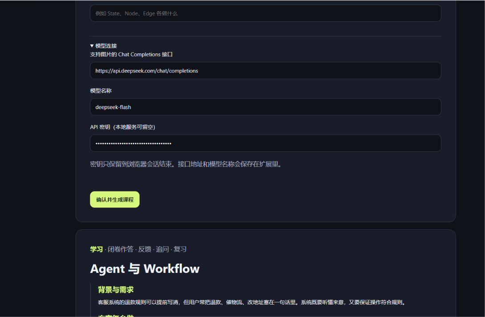
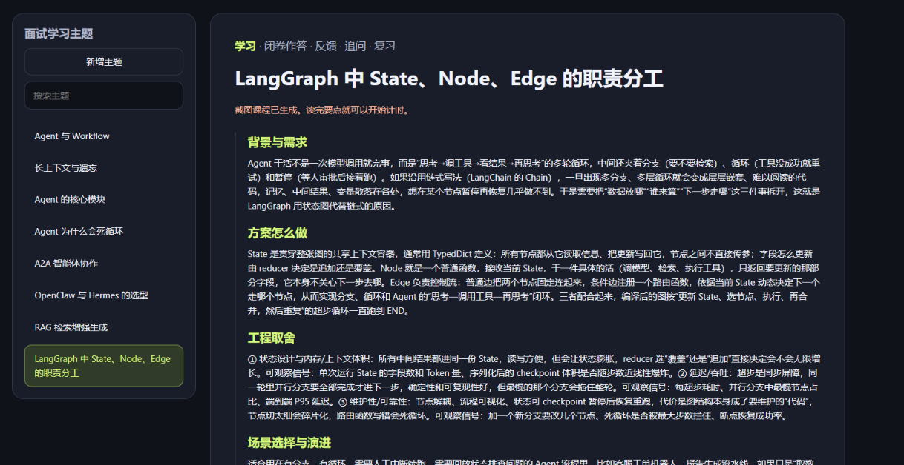
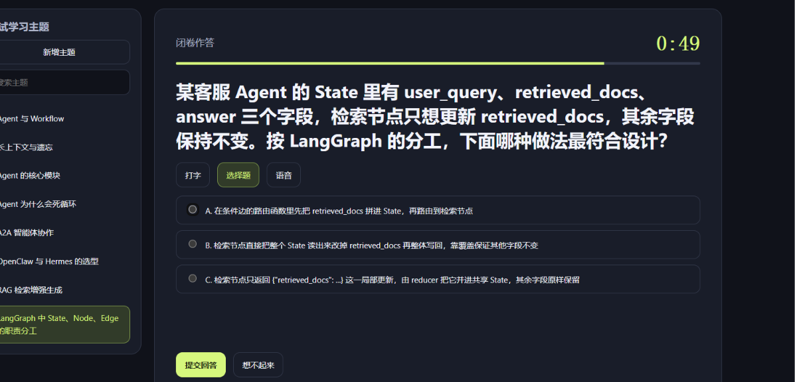

# MIRA 截图学习台

MIRA 是一个 Edge / Chrome 扩展。学习飞书文档或网页时，点一下扩展图标就能截取当前可见区域。确认后，MIRA 会用你配置的视觉模型，把截图整理成一节课和一轮面试练习。

课程沿着 **背景与需求 → 方案机制 → 工程取舍 → 使用场景** 展开，并给术语配上白话解释和比喻。每轮练习包括计时作答、反馈、追问和换场景复习。

## 安装

1. 下载仓库中的 [扩展 ZIP](mira-study-extension.zip) 并解压。也可以下载整个仓库，再找到 `extension/` 文件夹。
2. 在常用的 Edge 或 Chrome 地址栏输入 `edge://extensions` 或 `chrome://extensions`。
3. 开启「开发人员模式」，点击「加载解压缩的扩展」，选择**直接包含 `manifest.json` 的文件夹**。
4. 确认「MIRA 截图学习台」已开启。可以在工具栏的「扩展」菜单里将 MIRA 固定在工具栏。

飞书文档需要在安装了 MIRA 的同一个浏览器和用户配置中打开。更新本地代码后，回到扩展管理页点 MIRA 卡片上的「重新加载」。

## 从截图开始学习

1. 打开飞书文档或网页，滚动到想学的小节。点 MIRA 图标，或尝试 `Alt + Shift + M`。如果快捷键冲突，可在扩展管理页的「键盘快捷方式」里调整。
2. 确认新标签页里的截图。画面中有多个主题时，填写「优先学习的小节」。
3. 第一次使用时展开「模型连接」，填写服务商提供的图片兼容 Chat Completions 地址、模型名和 API 密钥。下表是 **DeepSeek 官方 API** 的示例。

   | 字段 | 填写内容 |
   | --- | --- |
   | 接口地址 | `https://api.deepseek.com/chat/completions` |
   | 模型名称 | `deepseek-flash` |
   | API 密钥 | 自己在 DeepSeek 官方平台创建的密钥 |

   其他服务商需要使用该服务商的完整接口地址和支持图片输入的模型。MIRA 接受以 `/chat/completions` 结尾的地址。 [DeepSeek 图像输入文档](https://api-docs.deepseek.com/guides/vision/)

4. 点「确认并生成课程」。首次连接某个模型域名时，浏览器会请求授权。核对域名后允许，等待课程生成。
5. 阅读课程，选 30、60 或 90 秒，点「开始计时」。可以打字、做选择题或使用浏览器语音转写。时间到时仍能提交。
6. 看反馈并做追问，再自评。还卡住的主题会进入当天复习。能讲清的主题先排到隔天，之后根据复测结果延长间隔。
7. 想直接复习时，右键 MIRA 扩展图标，选「打开 MIRA 学习台」，再进「复习队列」。

也可以在学习台手动新增主题，或粘贴目录批量导入标题。手动主题使用通用问题和笔记对照自评。截图生成的课程和内置题库还有选择题及参考要点。

## 界面截图

### 配置模型并确认生成

### 从截图生成结构化课程

### 计时闭卷练习

## 数据与权限

- 截图由工具栏点击或快捷键触发，仅截取当前标签页的可见区域。点「确认并生成课程」后，截图和页面标题才会发送给你配置的模型服务。模型费用和数据处理规则由服务商决定。
- 接口地址和模型名保存在扩展设置里，API 密钥保留在当前浏览器会话中。请勿把真实密钥写进代码、README 或提交记录。
- 主题、作答和复习队列保存在当前浏览器配置中，可通过「迁移学习记录」导出和导入 JSON 备份。备份会包含笔记和作答内容，请自行保管。
- 文字反馈按关键词匹配，适合提示遗漏。最终用自己的话和原资料核对。语音转写取决于浏览器及麦克风权限。

## 常见问题

| 问题 | 处理方法 |
| --- | --- |
| 浏览器提示找不到扩展清单 | 先解压，再选择直接包含 `manifest.json` 的目录。 |
| 点了快捷键没反应 | 先在普通网页上用扩展菜单点击测试，确认飞书和 MIRA 在同一个浏览器配置里。 |
| 截图里字太小 | 放大网页并滚动到目标段落后重截，一次处理一个小节。 |
| 模型报 400 或无法读图 | 核对模型是否支持图片，以及服务商是否接受 Chat Completions 的 `image_url` 输入。 |
| 模型报 401 或 403 | 确认密钥属于所填服务商，并检查权限和账户状态。 |
| 重开浏览器后要求重新输密钥 | 密钥按会话保存。接口地址和模型名会保留。 |

## 项目结构

- `extension/manifest.json` 声明 Manifest V3 扩展和权限。
- `extension/background.js` 负责截图和打开学习台。
- `extension/capture.js` 负责模型请求、生成课程和记录迁移。
- `extension/study.js` 负责主题、计时练习、反馈和复习。
- `extension/index.html` 提供界面。也可以直接打开这个文件体验手动练习。
- `mira-study-extension.zip` 是下载后可解压加载的安装包。

项目使用原生 HTML、CSS 和 JavaScript，无需安装 npm 依赖，也无需构建。
